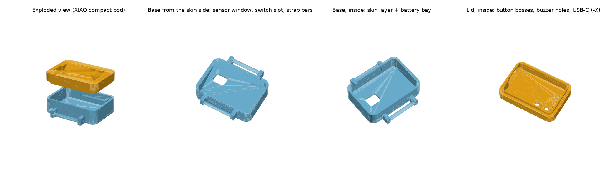
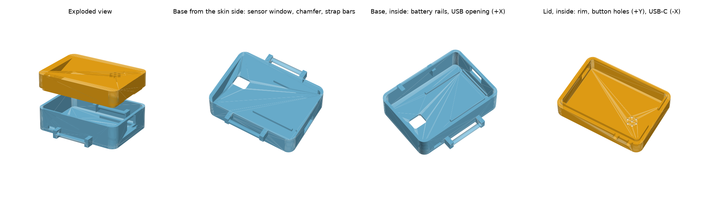

# Wrist pod enclosure

Two 3D-printable pods for the SmartVitals / Vital wristband, sized for a typical adult wrist
(circumference 16–18 cm, top of wrist ~55–60 mm wide). Each is generated by a parametric script: edit the
parameters at the top and re-run to resize.

| Files | Pod | Size (L × W × H) | Across wrist (with strap bars) |
|---|---|---|---|
| `case_base_xiao.stl` + `case_lid_xiao.stl` | **Compact**: Seeed XIAO ESP32-S3, battery inside (`make_case_xiao.py`) | **48 × 34 × 19.4 mm** | 46.4 mm |
| `case_base_xiao_led.stl` + `case_lid_xiao_led.stl` | Compact, for **12 × 12 × 7.3 mm LED tactile buttons** (variant `xiao_led` in `make_case_xiao.py`) | 52 × 34 × 19.4 mm | 46.4 mm |
| `case_base_pcb.stl` + `case_lid_pcb.stl` | *Concept* (future work): one custom PCB, LiPo 402530 (`make_case_pcb.py`) | 43 × 33 × 10.3 mm | 43.6 mm |
| `case_base_standard.stl` + `case_lid_standard.stl` | Original: ESP32 DevKit + DS3231 + TP4056, battery inside (`make_case.py`) | 64 × 46 × 27.4 mm | 58.4 mm |
| `case_base_slim.stl` + `case_lid_slim.stl` | Original, LiPo in a strap pocket | 64 × 46 × 20.4 mm | 58.4 mm |
| `case_base_led.stl` + `case_lid_led.stl` | Original, for **12 × 12 × 7.3 mm LED tactile buttons** (variant `led` in `make_case.py`) | 72 × 46 × 27.4 mm | 58.4 mm |

The long side runs along the forearm. Both take a 22 mm Velcro or nylon sport strap.

**3D assembly viewer:** [`viewer/index.html`](viewer/index.html) shows every component in place inside either pod
(switch between them with *Version*). You can explode the stack, click a part for its size, position and wiring,
and show the pod on a wrist with the strap. It opens straight from disk (keep `case_meshes.js` next to it); the two
scripts regenerate the meshes.



## Compact pod (XIAO ESP32-S3)

```
 lid    (XIAO layer, 5.5 mm)  XIAO ESP32-S3 on foam, USB-C through the thinned -X end wall (charge + flash)
                              FPC antenna stuck to the lid | coin motor | 9 x 4.2 mm buzzer under the sound holes
                              2 buttons glued under the bosses, stems through the top
 base   (battery, 6 mm)       LiPo 602535 (or 503035) on foam tape
 base   (skin layer, 4 mm)    MAX30102 face-down over the floor window | MPU6050 chip up | driver strip
                              (2x BC547 + 1k, 1N4148, 100k/100k divider) | SS12D00 switch, lever through the -Y wall
 skin
```

**Fit check and full 3D model:** `python hardware/enclosure/assembly_xiao.py` models every part as a solid in its
place, checks each one against the base, the lid and every other part, and writes **`assembly_xiao.glb`**: the case
plus all 13 parts in colour, assembled (opens in Windows 3D Viewer, Blender, Fusion 360 or any online glTF viewer).
Current result: no part overlaps the case or another part. The MAX30102, MPU6050, driver strip, switch, XIAO,
antenna, motor, buzzer and buttons rest directly on a case surface (gap 0 mm); the battery has 1.1 mm all round.

Parts it needs that the original did not: the XIAO ESP32-S3 (its FPC antenna comes in the box) and a 9 × 4.2 mm
buzzer (a 12 mm buzzer is too tall for the lid). It no longer uses the ESP32 DevKit, the DS3231, the TP4056 or the
AP2112K regulator.

Assembly:
1. Remove all header pins; use thin silicone wire. Bend the buttons' legs flat.
2. Glue the MAX30102 face-down over the floor window (chip flush with the outside), the MPU6050 flat beside it
   (chip up), the driver strip next to the MPU6050, and the switch in the -Y corner with its lever in the wall slot.
3. Foam tape, then the LiPo. Red lead through the switch to the XIAO's BAT+ pad, black to BAT− (pads under the board).
4. Foam tape on the battery, then the XIAO with its USB-C pushed into the -X port.
5. In the lid: buttons under the bosses (stems through the holes), buzzer under the sound holes, motor, antenna on the
   ceiling beside the XIAO. Snap the antenna's U.FL plug onto the XIAO.
6. Close the lid, thread the strap, flash with `pio run -e xiao-s3-hw -t upload`, then set `IMU_AXIS_SRC` /
   `IMU_AXIS_SIGN` and `TIME_ZONE` in `include/config.h`.

The XIAO charges at about 100 mA (≈ 5 h for 500 mAh) and only with the power switch on.

### Compact pod with 12 mm LED buttons (`xiao_led`)

For the 12 × 12 × 7.3 mm LED tactile buttons (for example the 5-colour LED kit), the case is 4 mm longer toward
the +X end: **52 × 34 × 19.4 mm**. The two buttons sit side by side across that end, glued straight under the lid,
with their lit square actuators through 7.6 mm square holes (about 1.4 mm above the lid). The vibration motor and
the buzzer move next to the XIAO; everything else is the same as the compact pod. `assembly_xiao.py` checks both
variants (no overlaps) and writes `assembly_xiao_led.glb`.

* Measure your buttons first: the body height (default `btn_body_h=4.3`) and the actuator size (`btn_act=7.0`,
  hole `btn_sq=7.6`) are typical values, not from the listing.
* Bend the 4 switch legs and 2 LED legs flat, sideways, before gluing.
* The LEDs are rated for 12 V. Try one on 3.3 V through 100 Ω: if it lights well, wire it to a spare XIAO pin
  (D6 or D7) through 100 Ω; if it is too dim it has a built-in resistor, so leave the LED pins unconnected.

## Custom-PCB concept (future work)

`python hardware/enclosure/make_case_pcb.py` models the phase-2 pod: every module replaced by one 39 × 29 × 1.0 mm
PCB, giving **43 × 33 × 10.3 mm** (about half the thickness of the compact pod). It runs the same fit check (no
overlaps) and writes `assembly_pcb.glb` plus the viewer's *Custom PCB* version.

```
 lid     LiPo 402530 (30 x 25 x 4 mm, ~180-200 mAh), clear of the antenna end; 3 sound holes over the buzzer
 board   top: ESP32-S3-MINI-1 (antenna at the +X edge), BMI270 IMU, MCP73831 charger + load switch + LDO,
              0825 coin motor, 5 x 5 mm buzzer, 2 side-push buttons (TPU plungers through the +Y wall)
         skin side: MAXM86161 optical module flush in the floor window, 4 pogo pads (5 V, GND, USB D+/D-)
 floor   1.4 mm with the sensor window and 4 pogo holes
```

Height: floor 1.4 + PCB 1.0 + parts 2.6 + battery 4.0 + gap 0.1 + lid 1.2 = 10.3 mm. A 3 mm cell gets it to about
9 mm. Part sizes are datasheet values and the PCB is not laid out yet, so treat this as a target, not a design.
The smaller cell needs the low-power firmware (deep sleep, WiFi only for alerts, wake-on-motion from the IMU).

## Original pod (ESP32 DevKit)



### Original pod with 12 mm LED buttons (`led`)

The DevKit pod for the 12 × 12 × 7.3 mm LED tactile buttons is 8 mm longer toward the -X end: **72 × 46 × 27.4 mm**.
The base layers (sensor, battery, ESP32 with its USB opening) do not move. In the lid, the TP4056, MPU6050 and
DS3231 slide 8 mm toward -X (the TP4056's USB-C opening moves with them, 1.6 mm toward the centre), the motor and
buzzer move into the freed space, and the two LED buttons sit side by side at the +X end, glued under the lid with
their lit actuators through 7.6 mm square holes. There are no side-button holes, and the power-switch slot moves
to x = −26 mm so it stays clear of the strap. A solid-model check of all 13 parts found no collisions. The same
LED-wiring and measuring notes as the compact LED pod apply.

## Printing (both pods)

| Setting | Value |
|---|---|
| Material | PETG (best: tougher, handles skin warmth) or PLA |
| Layer height | 0.2 mm |
| Walls / top-bottom | 3 walls, 4 top and bottom layers |
| Infill | 20 % |
| Orientation | Base: open side up (as exported). Lid: top plate on the bed (as exported); the compact lid's button bosses then point up and need no support |
| Supports | Base: "touching build plate only" under the two strap bars (or rely on bridging). Lid: none |

Print time is roughly 1.5–2 h for both parts of the original pod (about 25 g of filament) and about 1 h for the compact pod (about 14 g).

## What goes where (original pod)

```
 lid    (top layer)   +Y half: DS3231, buzzer under the sound holes, 2 buttons on the +Y wall
                      -Y half: TP4056 (USB-C at the -X end opening), MPU6050, vibration motor
 base   (middle)      ESP32 DevKit, header pins removed, USB toward the +X end opening
 base   (bottom)      MAX30102 face-down over the floor window | LiPo 602535 between the rails
                      +Y gutter: driver strip (perfboard: 2x BC547 + 1k, 1N4148, 100k/100k divider, AP2112K, 220 uF)
                      -Y gutter: SS12D00 slide power switch, lever through the slot in the -Y wall
 skin
```

## Assembly (original pod)

1. Remove all header pins; solder thin silicone wires (wiring: see the wiring diagram in the project notes).
2. Glue the MAX30102 face-down over the floor window so the sensor chip is flush with the outside of the floor.
3. Slide the LiPo between the rails; add a strip of foam tape on top. Glue the power switch in the -Y gutter with its
   lever in the wall slot, and the driver strip flat in the +Y gutter (transistors laid flat).
4. Lay the ESP32 on the foam with its USB connector in the +X opening.
5. Stick the top-layer modules into the lid with foam tape: buttons first (6 × 6 mm tactile, 7–8 mm tall,
   stems through the side holes), then DS3231, TP4056 (USB-C in the -X opening), MPU6050, buzzer, motor.
6. Press the lid on. The rim locates it; a dab of hot glue or two strips of Kapton tape hold it closed.
7. Thread a 22 mm Velcro or nylon sport-loop strap through both strap bars (fits 14–21 cm wrists).
8. After mounting, set the IMU orientation in `include/config.h` (`IMU_AXIS_SRC` / `IMU_AXIS_SIGN`).

## Before printing: measure your parts

The default sizes are typical values. If a part is bigger, change these parameters in `make_case.py`:

| Part | Parameter |
|---|---|
| ESP32 board length / width | `inner_l`, `inner_w` |
| Stack heights (battery, ESP32, top layer) | `battery_h`, `esp32_h`, `top_h` |
| USB connector position / size | `usb_w`, `usb_h`, `tp_y`, `tp_w`, `tp_h` |
| Sensor window position | `win_x`, `win_l`, `win_w` |
| Button positions | `btn_x`, `btn_d` |
| Power-switch slot | `sw_x`, `sw_l`, `sw_h`, `sw_z` |
| Lid fit (too tight / loose) | `fit` (default 0.2 mm) |

Then run `python hardware/enclosure/make_case.py` or `python hardware/enclosure/make_case_xiao.py` (needs `pip install manifold3d numpy matplotlib`). The compact pod's parameters have the same names, plus `skin_h`, `usb_*` (port) and `btn_xy`, `boss_h` (top buttons).
